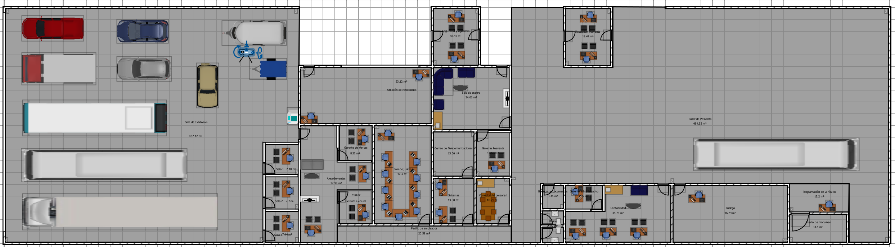
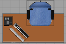
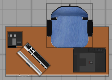
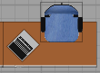
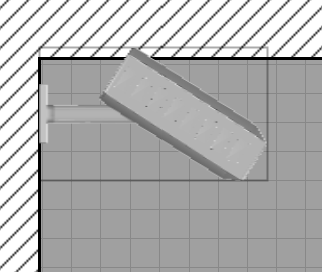
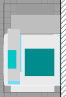
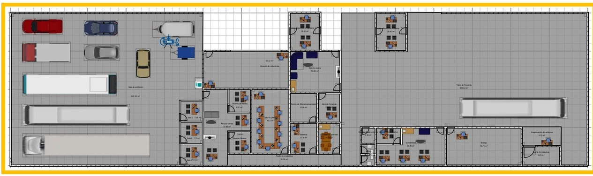
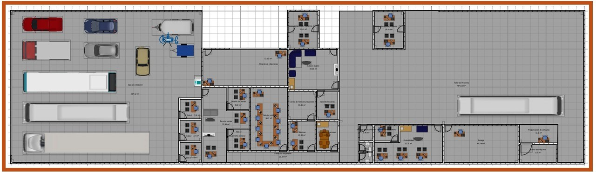
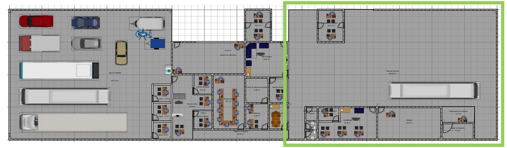

## Diseño de infraestructura de red para *Traveler*

### Contexto del proyecto
A partir del croquis arquitectónico de distribución y los requerimientos operativos de la empresa *Traveler*, se definieron las especificaciones técnicas iniciales para el despliegue de la infraestructura de red y cableado estructurado. 

    

---

Durante el levantamiento de requerimientos con el área de arquitectura, se establecieron los siguientes tipos de nodos y dispositivos finales:

### Especificación de nodos y servicios

#### Zona 1. Estaciones de trabajo fijas
Áreas asignadas al personal operativo para labores continuas.
* 1 nodo para computadora de escritorio.
* 1 nodo para teléfono IP (VoIP).

    

#### Zona 2. Estaciones de trabajo fijas con impresora
Puestos asignados con necesidad de impresión.
* 1 nodo para computadora de escritorio.
* 1 nodo para teléfono IP (VoIP).
* 1 nodo para impresora de inyección de tinta en red.

    

#### Zona 3. Estaciones de trabajo para equipos portátiles
Espacios temporales destinados a usuarios con computadoras portátiles que requieran conexión física a los servicios corporativos:
* 1 nodo de datos por estación para acceso alámbrico de alta disponibilidad.

    

#### Zona 4. Sistema de videovigilancia IP (CCTV)
Camáras IP 2k@30fps, distribuidas por toda la empresa para registrar las actividades realizadas dentro de los espacios de la empresa, estas deben funcionar 24/7.
* 1 nodo de red dedicado por cámara IP.
* El grabador de video en red (NVR) se concentrará directamente en el **Cuarto de Telecomunicaciones**.

    

#### Zona 5. Impresión de gran formato / Alto volumen
* 1 nodo de datos dedicado en el área de exhibición para una impresora corporativa de alta capacidad.

    

#### Zona 6. Servicio de red WiFi para clientes
El corporativo ha decidido proveer de red inalámbrica a todos sus clientes, consideran que el aforo total en la superficie de la empresa será de 100 usuarios simultáneos.

Se usará red mesh combinada (2.4 GHz y 5 GHz) con SSID "Travelers".

    

#### Zona 7. Servicio de red WiFi para empleados
El Corporativo requiere que se instale una red inalámbrica separada para los empleados, esta red cubrirá toda la superficie de la empresa y su aforo será de 50 usuarios.

Se usará red mesh combinada (2.4 GHz y 5 GHz) con SSID "Traveler Empleados".

    

#### Zona 8. Servicio de red WiFi para equipos del Taller de Posventa
El corporativo requiere una cobertura de red únicamente dentro del espacio del Taller de Posventa, esta será destinada a los equipos usados para las labores de diagnóstico y mantenimiento de los vehículos.

Se usará únicamente red 2.4GHz, con SSID "Traveler Posventa".

    

### Subsistemas
Para este apartado cada equipo deberá definir la distribución de su propuesta, lo que dará lugar a los subsistemas utilizados y las zonas relacionadas.